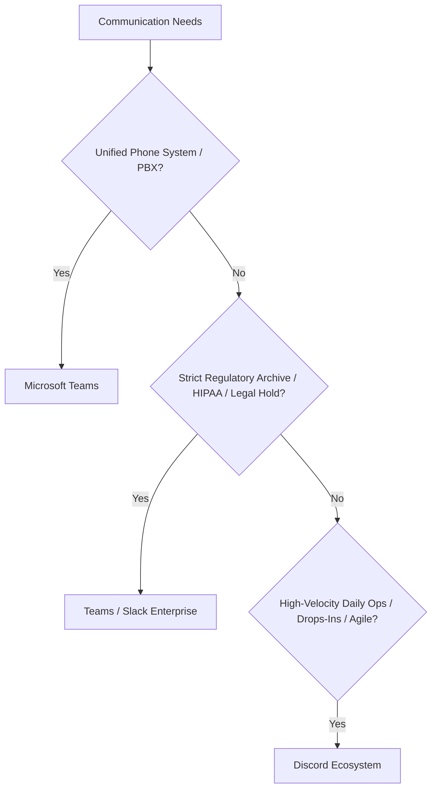
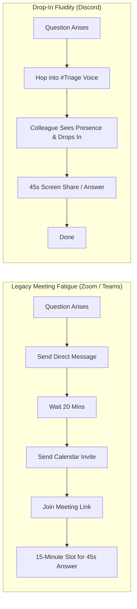

When setting up communication infrastructure for a new startup, consulting practice, or agile team under Keel Systems, one of the first questions on the table is: *"What platform should we use for day-to-day communication?"*

The default answers are predictable: Microsoft Teams, Google Workspace, Slack, or in informal settings, WhatsApp. 

While it is undeniably true that specific tools must match specific operational constraints—and enterprise compliance often dictates your hand—I frequently advocate for a platform that most corporations dismiss out of hand: **Discord**.

To understand why, we have to look past vendor marketing, examine what people actually do inside chat apps all day, and evaluate where each platform genuinely shines and where it quietly fails.

---

## 1. The Corporate Standards: An Honest Breakdown

Before contrasting Discord against the enterprise incumbents, let's give credit where credit is due. No single tool solves every organizational problem.



### Microsoft Teams: The Enterprise Standard & Telephony Hub
Microsoft Teams is the definition of corporate standard. Bundled directly into Microsoft 365 licensing, it checks every regulatory box for enterprise compliance audits, eDiscovery, and strict retention policies. 

If your organization requires granular tracking of file downloads, legal hold retention, or the ability to instantly retract documents and revoke network access the exact second an employee is terminated, Microsoft Teams paired with Entra ID makes that workflow turnkey.

Furthermore, **Teams' greatest superpower is its integrated PSTN telephony**. If your company needs an enterprise business phone system—complete with direct dial numbers, automated call routing, ring groups, and physical handset integration—having that live directly inside the Teams client is a massive operational win. In that scenario, keeping everyone on one platform makes complete sense rather than forcing users to juggle separate chat and phone apps. In a high-corporate enterprise setting that can afford the licensing and requires unified telephony, I still advocate for Microsoft Teams.

Where Teams struggles is everyday operational agility:
* **The Email Replacement Trap:** In practice, employees frequently use Teams as a lazy replacement for formal, structured email—firing off half-baked messages that demand immediate attention without providing the context or paper trail of a real email thread.
* **Sluggish Multi-Tenant Switching:** If you work with multiple clients or organizations, switching between Teams tenants remains a clunky, multi-second reload exercise.
* **System Resource Overhead:** The desktop client routinely consumes 1.2 to 2.5 GB of RAM, creating noticeable drag on non-workstation laptops.

### Slack: The $25 Emoji Reaction Problem
Slack revolutionized modern asynchronous team messaging. Its threading model remains the cleanest way to prevent cross-talk in dense discussion channels, and its API paved the way for modern webhooks.

However, Slack suffers from two severe operational problems:
1. **The Cost-to-Utility Mismatch:** Small businesses are regularly shocked by initial plan quotes ($8.75 to $15 per user, per month) that scale brutally the moment you bring on contractors or multi-department teams.
2. **The Adoption Desert:** Because Slack is so often purchased top-down by leadership without an organic daily communication rhythm, usage quickly withers. I’ve seen organizations spend thousands on premium Slack plans only to discover that virtually nobody used it. Management’s desperate solution? Offering employees an extra $25 on their weekly paycheck just to log into the app and click an emoji reaction during the week. When you have to literally bribe your staff to click a thumbs-up emoji on an announcement, your communication tool has failed.

### WhatsApp: Fast, Agile, Completely Unmaintainable
Many trades, small contractors, and field teams default to WhatsApp groups simply because everyone already has the app installed on their personal smartphone. It requires zero training and launches instantly.

As soon as a company scales past five people, however, WhatsApp turns into operational liability:
* No administrative role hierarchies or permissions.
* No message threading or topical separation.
* No institutional data retention or corporate offboarding when staff leave.
* Blurring of work-life boundaries that breeds burnout.

---

## 2. Why Discord is Built for Velocity

Discord was engineered from the ground up for real-time multiplayer gaming—meaning it was forced to solve the hardest technical problems in networked communication first: sub-30-millisecond voice latency, minimal CPU/RAM overhead, crystal-clear screen sharing, and resilient websocket connections over volatile networks.

When you strip away the gamer branding and dark-pattern marketing, you are left with one of the most fluid, resilient communication engines in existence.

### Defeating "Phone Tag" with Drop-In Voice
Modern work culture is plagued by phone tag. An engineer needs a 45-second clarification from a project lead. They call; the lead is away. The lead calls back ten minutes later; the engineer is in a deep work block. They exchange four asynchronous messages before finally scheduling a formal calendar invite for a 15-minute Zoom meeting three hours later.

Discord’s voice architecture completely short-circuits this friction:
* **Persistent Voice Rooms:** Instead of scheduling calendar links, you have dedicated persistent voice rooms (`#co-working`, `#triage`, `#hallway`). 
* **One-Click Rooms:** Need to talk through a ticket? Click a single button to hop into an open room or create a private channel. You sit there with your mic muted while doing your work; the moment the other person is free, they hop in, you talk for 60 seconds, and they drop out.
* **Low-Latency Opus Codec:** Powered by WebRTC and the Opus audio codec over UDP, voice latency is imperceptible (<30ms). Built-in Krisp AI noise cancellation filters out background fan noise, mechanical keyboards, and dog barks without expensive audio interfaces.
* **Frictionless 60 FPS Screen Share:** Two engineers can stream their displays simultaneously into the same voice room with zero meeting links or host approval dialogues.



### Granular Bitmask Permissions & Role Hierarchies
A common objection from IT directors is that Discord lacks access control. In reality, Discord possesses one of the most robust 64-bit permission bitmask models available:

* **Category-Level Inheritance:** Permissions cascade naturally from server categories down to individual text and voice channels.
* **Lockdown by Default:** By revoking `@everyone` permissions on all read/write/connect flags, the server behaves as a zero-trust environment.
* **Isolated Multi-Tenant Access:** You can bring clients and third-party contractors directly into your server without leaking internal channels. A role like `@client-acme` can only see their dedicated `#acme-updates` and `#acme-voice` rooms, with the server member list shielded so they cannot even see who else is in the organization.

---

## 3. The Developer Ecosystem & Autonomous Bots

Slack apps often require complex OAuth2 handshakes, enterprise manifest configurations, and hosted backend servers. Discord’s webhook and bot API, by contrast, is a developer’s dream.

With a standard incoming webhook, any system can push rich, interactive JSON embeds into a dedicated channel in two lines of Python or bash:

```python
import aiohttp

async def send_triage_alert(webhook_url: str, alert_data: dict):
    payload = {
        "username": "Keel Telemetry",
        "embeds": [{
            "title": f"🚨 {alert_data['source']} Alert",
            "description": alert_data['message'],
            "color": 0xE74C3C if alert_data['severity'] == "CRITICAL" else 0xF39C12,
            "fields": [
                {"name": "Endpoint", "value": alert_data['host'], "inline": True},
                {"name": "Action Taken", "value": alert_data['remediation'], "inline": True}
            ]
        }]
    }
    async with aiohttp.ClientSession() as session:
        await session.post(webhook_url, json=payload)
```

At Thoms Foolery and Keel Systems, I took this philosophy to its logical conclusion: building an **Autonomous Community Operating System** using Python, SQLite3 WAL mode, and Agentic AI. 

In a business context, custom Discord bots can:
1. **Automate Support Ticket Ingestion:** Parse inbound client emails and post them to a `#triage` room with claim buttons.
2. **Context Summarization:** Let technicians trigger `/summarize` to condense 100 chaotic troubleshooting messages into a 4-bullet executive recap.
3. **Automated Onboarding:** Assign department-specific role channels and delivery runbooks the instant a new hire joins.

---

## 4. The Elephant in the Room: The "Gamer" Optics

The only genuine barrier to Discord adoption is optics. When a traditional CTO hears "Discord," they picture teenagers playing video games with animated anime avatars.

Here is how we address that objection honestly:

1. **Clear Architectural Demarcation:** Discord is your **high-velocity digital workshop**, not your compliance record vault. Sensitive legal documents, patient health records, and payroll data belong in hardened, encrypted storage vaults (Git, Datto, EHR, ERP)—not sitting in unindexed chat channels on *any* platform.
2. **The Turnkey Polish:** When styled properly—custom company emoji sets, professional iconography, strict role palettes, and clean category layouts—a Discord workspace feels cleaner, faster, and far more modern than the bloated web apps of 2015.
3. **Right Tool for the Right Organization:** If you are a 5,000-seat healthcare network needing HIPAA-certified chat logs, use Microsoft Teams. But if you are an agile development team, creative agency, managed service provider, or lean startup, Discord will give your team a massive competitive advantage in velocity and morale.

---

## 5. Let Keel Systems Build Your Digital Office

Most organizations overlook Discord simply because they don't know how to architect it for a professional enterprise environment. Setting up default permissions without a zero-trust model leads to chaotic channels, notification fatigue, and accidental data exposure.

That is where **Keel Systems** steps in.

I provide turnkey architecture, security hardening, and ongoing bot development for businesses and remote teams:
* **Turnkey Server Deployment:** Zero-trust role hierarchies, clean category inheritance, client isolation channels, and distraction-free notification rules.
* **Custom AI & Automation Bots:** Ingesting CRM alerts, GitHub commits, automated shift summaries, and intelligent triage agents.
* **SaaS Cost Remediation:** Migrating agile teams off bloated $15/user/month Slack tiers to save thousands in annual recurring licensing overhead.

You don't need to pay enterprise ransoms for software that slows your team down. You just need the right tools, configured honestly.

---

> [!TIP]
> **Ready to modernize your team's communication?**  
> Explore the technical architecture behind our custom bots in [The Architecture of an Autonomous Community Operating System](/articles/building-a-comprehensive-discord-ecosystem.html), or reach out directly at **social@thomsfoolery.com** to discuss building a custom digital office with Keel Systems.
