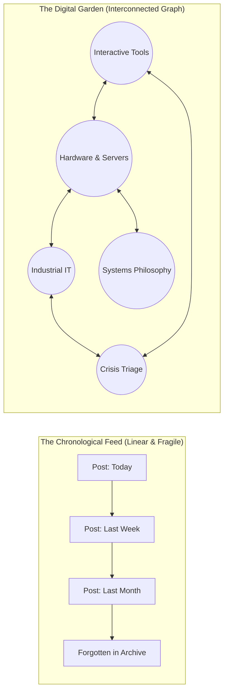
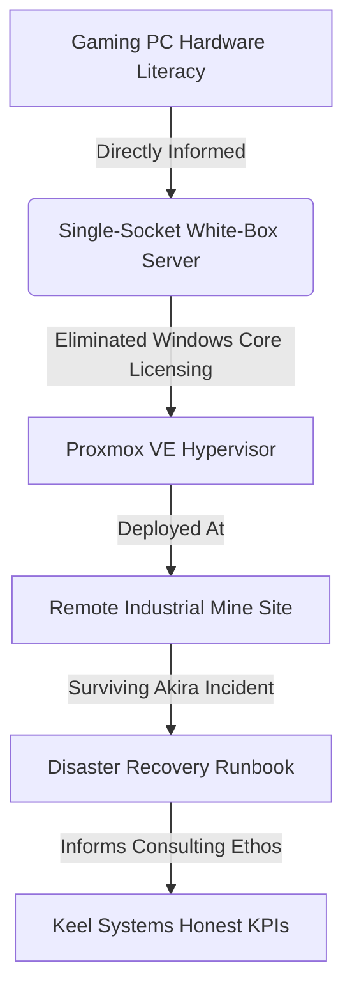

> *"The reason you make your decisions the way you do today is the product of every event and circumstance that has shaped your life up to this moment."*

---

## 1. The Central Idea

Project Atlas is built on a single, uncompromising premise:

**Everything is connected.**

Not in an abstract or spiritual sense, but in a precise, traceable, and mechanical reality. The things that appear completely unrelated from the outside are often tied together by deep structural load paths.

The lens through which you analyze a broken system, the tools you reach for under pressure, the patterns you recognize across disparate data, and the places where you refuse to accept conventional wisdom—none of them happen in a vacuum. Every current instinct has a lineage.

Consider a practical example: years of building custom gaming PCs in my spare time—obsessing over component clearances, thermal dissipation, memory timings, and bus lane saturation—directly enabled me to spec out an enterprise-grade Bill of Materials for a custom white-box server at an industrial fluorspar mine. That single project replaced an aging, failing OEM server and avoided tens of thousands of dollars in proprietary per-core hypervisor licensing by deploying Proxmox VE. 

To an outside observer, assembling a gaming desktop has nothing to do with industrial hypervisor architecture. In practice, the mental models are identical: understanding component-level constraints, reading specifications rather than brochures, and designing for thermal and operational resilience.

The way I diagnose an erratic network loop connects to the way I evaluate fluid dynamics in mechanical engineering. The discipline required to track sabermetric momentum curves across 162 baseball games connects to the heuristic analysis that spotted an active ransomware infiltration at 4:43 AM. 

None of these connections are obvious on a resume. That is precisely why standard portfolios fail.

---

## 2. Why the Corporate Brochure Fails

Standard portfolio websites, resumes, and chronological blogs are fundamentally inadequate for representing how a systems-first mind operates. They are linear, sterile, and artificial. They force human experience into rigid corporate compartments: *here is my professional bio, here is my GitHub link, here is my reverse-chronological list of articles.*

The problem with chronological feeds is that they discard context. The moment an article slips past the first page of an archive, it is treated as obsolete, regardless of its relevance to a project built three years later. Silos present thinking as a disconnected pile of disparate tasks, rather than a continuous, compounding body of work.

I didn't want to build an "algorithm machine"—a site engineered to chase clicks, push intrusive popups, or demand that readers read only whatever was published yesterday. 

Instead, I built **Project Atlas** as a digital garden designed around how I actually enjoy browsing:
* You might not care about the latest essay, but you came to use an interactive **MLB Postseason Momentum Analyzer** or practice melodies on an **N64 Ocarina Tool**.
* You might arrive seeking an IT infrastructure audit, follow an edge into self-hosted hypervisors, and end up reading about mechanical failure modes in remote mines.
* It is a naturally flowing, self-directed exploration with zero algorithmic manipulation.

---

## 3. The Mechanics: Nodes and Edges

To turn this philosophy into software, Project Atlas was engineered as a relational graph rather than a traditional static blog. 

Every essay, interactive tool, open-source project, and architectural blueprint is a **node**. Every shared concept, technical dependency, and structural influence is an **edge**. 

When you inspect a project on this platform:
- You don't just see a static description; you see the live projects that consume it, the foundational articles that explain its design decisions, and the interactive tools demonstrating its mathematics in the browser.
- A technical analysis of Discord's WebRTC audio architecture links directly to the production code of an autonomous Python community bot and the consulting service offering that deploys it.
- A hardware teardown of diode laser kerf math links directly to physical CAD storage designs and small-scale manufacturing economics.

The graph database mechanically reflects the reality of cognition: high-density pattern recognition operating across disciplines without artificial boundaries.

---

## 4. For Readers: How to Explore

When you interact with the 3D knowledge graph or the interactive nodes on this site, there is no required reading order. 

> [!TIP]
> **Abandon Chronological Reading:**  
> Pick a topic that interests you—whether that is sabermetrics, disaster recovery, hardware modding, or digital offices. Open the drawer, examine the concepts, and follow the **Connected Content** down whatever rabbit hole catches your curiosity.

The value of a digital garden is not found in skimming isolated articles; it is found in discovering the connective tissue between them. 

---

## 5. The Underlying Reality

At the end of the day, there is a quiet realization that doesn't need to be shouted from a billboard:

I am not just one of the branches extending outward from Thoms Foolery. I am the entire system, operating all at once. The physical craftsmanship, the technical infrastructure, the mathematical models, the music, and the lived experiences do not exist in separate containers. 

None of it can exist without everything else.

**Everything is connected.**

Welcome to the Atlas.
