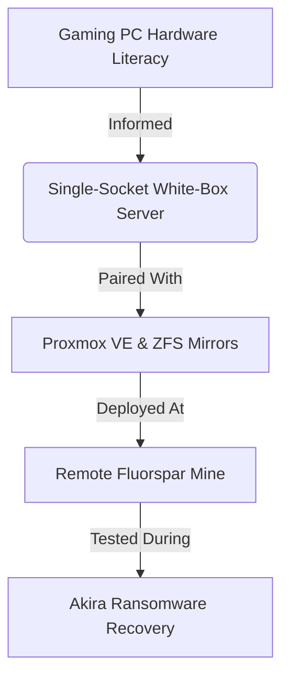

> *"The reason you make your decisions the way you do today is the product of every event and circumstance that has shaped your life up to this moment."*

---

## From a Home Workbench to a Mine Server Room

For years, I spent my evenings building and tuning desktop and gaming PCs—worrying about case airflow, VRM heat sinks, memory timings, and PCIe lane layouts. On paper, building a gaming rig at home has nothing to do with industrial enterprise IT.

Then an $80,000 OEM server renewal quote landed on my desk at a remote fluorspar mine on the Burin Peninsula. Because I knew what an enterprise NVMe drive, an AMD EPYC board, and Registered ECC memory actually cost—and how they actually fail—I knew we didn't need a dual-socket branded box with a four-hour warranty that no courier could honor in a blizzard. We built a single-socket white-box Proxmox server with a shelf of local warm spares for a fraction of the price.

The same pattern repeats everywhere across my work:
* Studying fluid dynamics and tolerances in mechanical engineering shapes how I trace bottlenecks in a network rack.
* Scoring Toronto Blue Jays games by hand in a paper scorebook led directly to writing the [162-Game Run Differential Analyzer](/tools/baseball-trend-analyzer/) and the [3D ABS Umpire Pitch Simulator](/tools/umpire-simulator/).
* Practicing a 12-hole Alto C ceramic ocarina by ear turned into writing a browser-native Web Audio autocorrelation pitch detector for the [Ocarina Practice Suite](/tools/ocarina/).

None of those links show up on a traditional resume. That is why standard portfolio websites always felt wrong to me.

[Photo slot: /images/articles/workbench-nodes-flatlay.jpg — Top-down workbench flat-lay showing an ECC server DIMM, a laser-engraved slate coaster, a 12-hole ceramic ocarina, and a pencil-scored baseball scorebook]

---

## Why Chronological Blogs Lose the Thread

A traditional blog sorts everything by a single dimension: the date it was published. The moment an essay drops off page one, it gets buried in an archive, even if it explains the exact design behind a tool you shipped two years later. Standard portfolios force you to pretend that your day job, your workshop projects, and your hobbies belong in separate silos.

I built **Project Atlas** as a connected graph instead of a chronological feed.

Every essay, interactive tool, hardware build, and interest on this site is a node, and every shared dependency or idea is an edge. You might arrive here looking for a [GTA V 100% completion checklist](/tools/gta-v-tracker/) or an [OSRS bank skilling calculator](/tools/osrs-bank-skilling/), follow a link into how the zero-dependency static compiler works, and end up reading about [how we rebuilt sixty endpoints from bare metal after a 4:43 AM ransomware alert storm](/articles/my-story-with-the-akira-ransomware-attack.html).

<section class="graph-container" style="position: relative; margin: 2.25rem 0; padding: 0; border-radius: 8px; overflow: hidden; border: 1px solid var(--border-color);">
  

    

      
Interactive Knowledge Graph — Full Map

      
Articles, Tools, Interests, and Resume roles connected across the site. Drag or click any node to explore.

    

    <a href="/graph/" class="inline-tool-link" style="font-size: 0.85rem;">Full Graph View &rarr;</a>
  

  

    

      <input type="text" id="graph-search" class="graph-search-input" placeholder="Search the map..." style="padding: 0.6rem 0.95rem; border-radius: 6px; border: 1px solid var(--border-color); background: rgba(11, 15, 25, 0.88); color: #fff; width: 195px; font-size: 0.88rem; outline: none;">
      <button id="graph-reset-btn" class="graph-reset-btn" type="button" title="Reset Graph Layout" style="padding: 0.6rem 0.85rem; border-radius: 6px; border: 1px solid var(--border-color); background: rgba(11, 15, 25, 0.88); color: var(--accent-cyan); font-size: 0.84rem; font-weight: 600; cursor: pointer;">
        Reset
      </button>
    

  

</section>

---

## How to Use This Site

There is no intended reading order here. Pick a node on the map above, test one of the [interactive tools](/tools/), check [what I'm working on this month (/now)](/now/), or follow the connected links at the bottom of any essay wherever your curiosity takes you.
