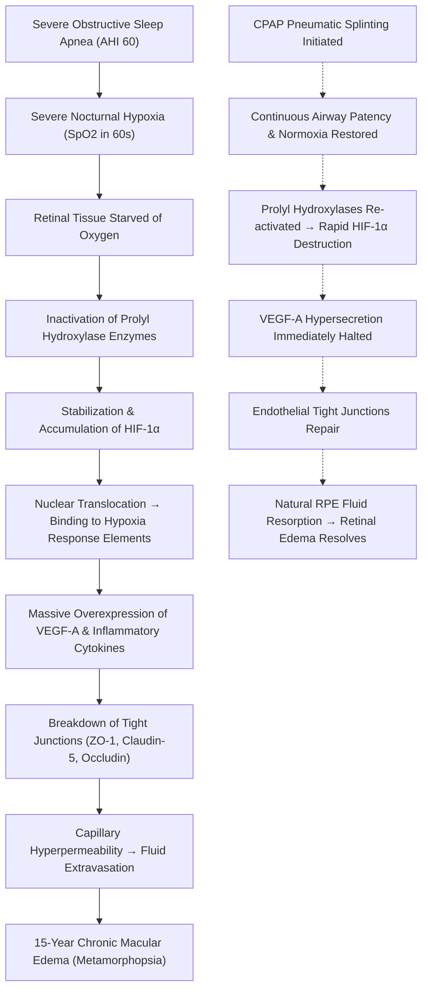

I spent the first three decades of my life suffocating in the dark, and I didn't even know it.

For as long as I can remember, I snored. As a kid, it was treated as a family punchline or a mild social liability. It made childhood sleepovers awkward; friends would wake up complaining about the chainsaw noise coming from my sleeping bag, or throw pillows at my head in the middle of the night just to buy themselves twenty minutes of quiet. You laugh it off when you're ten years old because you don't know any better.

By high school, the laughter stopped, and the real physiological consequences began taking root. 

I didn't have a frame of reference for what true, restorative rest felt like. When you grow up in a body that has never experienced continuous oxygen delivery during sleep, your brain performs a dangerous, quiet act of survival: **it normalizes chronic, severe impairment as your baseline reality.**

| Diagnostic Telemetry | Clinical Reading | Physiological Impact |
|---|---|---|
| **Apnea-Hypopnea Index (AHI)** | `60.0 events / hour` | Complete airway collapse once every 60 seconds; zero restorative deep sleep |
| **Nocturnal Oxygen Nadir ($\text{SpO}_2$)** | `Mid-60s%` | Arterial $\text{PaO}_2 \approx 30\text{ mmHg}$; equivalent to summiting Mt. Everest without oxygen |
| **Diagnostic Modality** | `Level 3 HSAT (Take-Home)` | Cardiorespiratory monitoring belt, nasal cannula, and continuous pulse oximetry |
| **Regulatory Standing** | `Mandatory Provincial Reporting` | Section 174.1 Newfoundland HTA; triennial Motor Registration compliance audit |
| **Ophthalmic Complication** | `Cystoid Macular Edema (2010)` | 15-year chronic retinal leakage driven by hypoxia-induced VEGF hypersecretion |
| **Therapeutic Outcome** | `Full Clinical Resolution` | Complete cessation of daytime somnolence and unassisted retinal recovery on CPAP |

---

## Act I: The Normalization of Exhaustion

When you live with untreated severe sleep apnea, exhaustion ceases to be a symptom and becomes the air you breathe. You assume everyone around you feels exactly the same way, but that they're just tougher, more disciplined, or better at "powering through."

I genuinely believed that when you were driving on the highway, it was completely normal to be fighting to keep your eyes open. 

```
                               THE HIGHWAY MICROSLEEP REALITY
  ┌─────────────────────────────────────────────────────────────────────────────────┐
  │ Highway Speed: 100 km/h (27.8 meters/second)                                    │
  │                                                                                 │
  │   0 sec                1 sec                2 sec                3 sec          │
  │   ├────────────────────┼────────────────────┼────────────────────┤          │
  │   [ Eyes Heavy ]       [ Brain Shuts Down ] [ Complete Sleep ]   [ Rumble Strip ]│
  │                                                                                 │
  │   Distance Traveled In The Dark: 83.4 METERS (Length of a Football Field)      │
  └─────────────────────────────────────────────────────────────────────────────────┘
```

If you punched a grueling ten-hour day at work, or if you had to drive four hours across the province on the Trans-Canada Highway, of course you were going to doze off behind the wheel. Everyone nods off a little, right? You crack the driver's side window to let freezing Atlantic air blast your face. You turn the stereo up until the door speakers rattle. You chug energy drinks and slap yourself on the cheek. 

When you get home from work and collapse onto the couch to watch television, it felt completely natural to pass out within three minutes of sitting down. You didn't view it as a medical emergency; you viewed it as the earned tiredness of a hard day's work. 

I was unintentionally putting up with a state of physiological decay that would have landed me in an emergency room had it occurred during the day. But because it happened under the cover of night, behind closed bedroom doors, I carried it alone for years.

---

## Act II: The Wall of Medical Stigma

Why didn't I seek help sooner? 

The answer is simple, infuriating, and tragically common: **medical stigma and fear.**

Growing up, I watched my father battle the exact same exhaustion. And I watched how the medical system treated him. When he sought help, the response he received from healthcare professionals wasn't compassionate diagnostic inquiry; it was dismissive scolding. He was told that his snoring and his fatigue were his own fault. The prescription was always the same lazy, unexamined directive: *"Just lose weight."*

That experience burned a false, toxic lesson into my subconscious: *If you go to a doctor and tell them you snore and you're tired, they aren't going to help you. They're just going to lecture you, shame you, and tell you to lose weight.*

> [!WARNING]
> **Diagnostic Overshadowing in Healthcare:** When clinicians reduce complex physiological conditions to a patient's body mass, it creates "diagnostic overshadowing." Rather than investigating upper airway biomechanics, patient complaints are dismissed as lifestyle failures, delaying life-saving interventions by decades.

Even when I was at my absolute healthiest—working out consistently, lifting heavy, eating clean, and in peak physical condition—I was still suffering from severe sleep apnea. My airway did not care about my gym routine. But the fear of walking into a clinic only to be humiliated kept me away.

On top of the weight bias, I had misconceptions about the diagnostic process itself. I was under the impression that getting tested meant being admitted to a cold hospital ward overnight, covered in hundreds of glued wires, while nurses watched me through a two-way mirror like a zoo animal. For an autistic person with severe sensory sensitivities, the idea of an in-hospital sleep lab felt like an intolerable psychological torture chamber.

So I stayed silent. I adapted. I drank more caffeine, fought the heavy eyelids on the highway, and continued to slowly drown in my own bed.

---

## Act III: The Weekend Take-Home Test

When I finally broke through the wall of hesitation and spoke to my physician, the reality was entirely different from the nightmare in my head.

There was no hospital admission. There was no sterile bed or overnight audience. Instead, I was handed a **Level 3 Home Sleep Apnea Testing (HSAT)** kit to take home for the weekend: an elastic thoracic effort belt to monitor chest displacement, a nasal pressure cannula to measure airflow, and a digital pulse oximeter clipped to my finger. I took the equipment home on Friday, slept in my own bed, and returned it to the hospital on Monday morning.

```
       LEVEL 1 HOSPITAL PSG                  LEVEL 3 TAKE-HOME HSAT
  ┌───────────────────────────────┐     ┌───────────────────────────────┐
  │ • 12–24 Month Waitlist        │     │ • Picked up for the weekend   │
  │ • In-patient hospital bed     │     │ • Slept in own comfortable bed│
  │ • 16+ glued EEG/EMG electrodes│     │ • 3 core non-invasive sensors │
  │ • Technologist watching live  │     │ • Returned to hospital Monday │
  └───────────────────────────────┘     └───────────────────────────────┘
```

There was only one catch, and it was the hardest physical part of the entire study: **I had to sleep completely flat on my back.**

For someone who naturally curls onto their side to survive, sleeping supine felt like fighting against gravity. But clinically, that instruction was deliberate. When you sleep flat on your back, gravity exerts maximum downward force on the base of your tongue and soft palate, pulling them directly against the posterior pharyngeal wall. It eliminates the protective posture of side-sleeping and exposes your airway's true, uncompensated baseline vulnerability.

I barely felt like I slept at all that weekend. The chest monitor tightened with every breath, and lying flat felt unnatural. On Monday morning, I packed the unit into its case, handed it back over the hospital counter, and went about my week, expecting the results to come back with mild or borderline numbers.

I was not prepared for what the data revealed.

---

## Act IV: The Data Shock & The Government Audit

A few days later, my physician called me in to review the report. The telemetry was staggering:

* **Apnea-Hypopnea Index (AHI): 60.0 events per hour.**
* **Nocturnal Oxygen Saturation ($\text{SpO}_2$): Dropping into the mid-60s%.**

To understand those numbers, you have to understand human respiratory physiology. 

In clinical medicine, an AHI over 30 is classified as *severe*. An AHI of 60 means that **every sixty seconds of my sleep, my airway completely closed off, my lungs stopped exchanging air, and my brain began to suffocate.** I was spending nearly half of every night in active asphyxiation. The brain never achieved slow-wave delta sleep or REM sleep; the second it attempted to relax, the throat collapsed, triggering an emergency adrenaline spike to shock me awake just enough to gasp for breath.

```
  100% ──── NORMAL SATURATION (95–100%)
       │
   90% ──── THE HYPOXEMIC CLIFF (PaO2 ~ 60 mmHg)
       │    Rapid oxyhemoglobin unloading begins
       │
   78% ──── HIGH-RISK SUDDEN CARDIAC ARREST THRESHOLD (Mayo Clinic Study)
       │
   65% ──── JONATHAN'S RECORDED NOCTURNAL NADIR (PaO2 ~ 30-35 mmHg)
            CRITICAL CELLULAR HYPOXIA / SUMMIT OF MT. EVEREST WITHOUT OXYGEN
```

And then there was the oxygen. Normal blood oxygen saturation sits between 95% and 100%. If a patient in an emergency room drops below 90%, alarm bells ring and oxygen masks are slapped onto their face. When your blood oxygen drops into the **60s%**, you have fallen off the steep precipice of the oxyhemoglobin dissociation curve. Your arterial partial pressure of oxygen ($\text{PaO}_2$) collapses to **30–35 mmHg**. That is the atmospheric oxygen tension found at the **summit of Mount Everest**. 

Sixty times an hour, all night long, my heart was being subjected to the hemodynamic equivalent of an intense sprint while starved of oxygen, pumping against massive negative intrathoracic pressure.

My doctor looked across the desk at me with complete gravity. Because of the severity of the numbers and the dangerous daytime drowsiness I had normalized, she explained that she had no choice: **under Section 174.1 of the Newfoundland and Labrador Highway Traffic Act, physicians have a mandatory legal duty to report drivers with hazardous medical impairments directly to the Motor Registration Division (MRD).**

```
┌─────────────────────────────────────────────────────────────────────────────────┐
│                    GOVERNMENT REGULATORY COMPLIANCE AUDIT                       │
├─────────────────────────────────────────────────────────────────────────────────┤
│ Governing Body:   Motor Registration Division (MRD) — Medical Review Section    │
│ Statutory Duty:   Section 174.1 Newfoundland & Labrador Highway Traffic Act     │
│ Safety Standard:  CCMTA National Safety Code Standard 6 / CMA Driver's Guide    │
│ Telematics Audit: ResMed AirView Cellular Telemetry (3-Year Cycle)              │
│ Mandatory Rule:   Usage ≥ 4.0 Hours/Night on ≥ 70% of Days (21 of 30 Nights)   │
│ Penalty Clause:   IMMEDIATE ADMINISTRATIVE SUSPENSION OF DRIVER'S LICENSE       │
└─────────────────────────────────────────────────────────────────────────────────┘
```

My driving privileges were placed under strict conditional review. Every three years, I am subjected to a mandatory government medical audit. A cellular modem inside my CPAP machine beams my exact breathing logs, run-time hours, and residual apnea data directly to the cloud. If my records show that I have failed to use my machine for **at least 4 hours per night on 70% of nights**, the provincial government will immediately suspend my driver's license.

Some people might resent that level of government oversight. I don't. Knowing what an AHI of 60 does to the human brain—and knowing how many drivers are sharing the highway while experiencing involuntary 5-second microsleeps—that audit is a necessary line of defense for public safety.

---

## Act V: The Cellular Miracle & The Macular Edema Connection

I will never forget the first week I used my CPAP machine. 

I put on the mask, adjusted the headgear, and let the pressurized air act as a **pneumatic splint**, physically propping open the tissue in my throat that had collapsed every night of my life.

Within **48 to 72 hours**, the transformation was so violent and immediate it was disorienting:

* The perpetual leaden weight behind my eyes vanished.
* The mid-afternoon brain fog that felt like wading through wet cement completely burned away.
* The urge to nod off behind the wheel disappeared entirely. I could drive for hours with sharp, effortless vigilance.
* I could sit on the couch after dinner, watch a movie with my family, and stay wide awake.

All of the symptoms that I had spent fifteen years rationalizing as "just who I was" or "normal tiredness" were gone in three days. My brain was finally being fed oxygen.



### The 15-Year Retinal Connection
In 2010, I began developing vision complications. I was diagnosed with **macular edema**—a condition where fluid leaks into the central retina (the macula), causing blurred vision, distortion, and structural swelling. 

For years, it was treated as an isolated ophthalmic mystery. But in Project Atlas, the core philosophy has always been that **everything is connected**. When I started full-time CPAP therapy, something remarkable happened: **my macular edema began stabilizing and improving on its own, without invasive eye injections or surgical intervention.**

At the time, it felt like an incredible coincidence. But when you look at the cellular biology, it wasn't a coincidence at all—**it was direct biochemistry**:

1. **The Retina's Oxygen Appetite:** The human retina has one of the highest metabolic rates of any tissue in the human body, consuming oxygen at a rate higher than the brain cortex. It is acutely sensitive to oxygen starvation.
2. **The HIF-1$\alpha$ / VEGF Trigger:** When my oxygen plummeted into the 60s every night, retinal cells went into acute hypoxic crisis. This inactivated the enzymes that normally break down **Hypoxia-Inducible Factor 1-alpha (HIF-1$\alpha$)**. HIF-1$\alpha$ accumulated, moved into the cell nuclei, and commanded the retina to produce massive, emergency surges of **Vascular Endothelial Growth Factor (VEGF)**.
3. **The Leaky Sieve:** VEGF's biological job is to signal for new blood vessels when tissue is starving. But in high concentrations, VEGF destroys the tight junction proteins (**claudin-5, occludin, and ZO-1**) that seal the blood-retinal barrier. My retinal capillaries became porous sieves, leaking fluid directly into the macula every night.
4. **Why Eye Injections Fail Alone:** In 2012, **Dr. Rebecca H. Mason and colleagues** published a landmark study in *Retina* demonstrating an overwhelming prevalence of undiagnosed sleep apnea in patients with macular edema. Many patients with sleep apnea become "treatment-resistant" to expensive anti-VEGF eye injections because every time they go to sleep, their untreated apnea turns the VEGF faucet back on.
5. **The CPAP Fix:** The moment CPAP kept my airway open, the nocturnal hypoxia stopped. HIF-1$\alpha$ was degraded, the VEGF faucet was turned off, and my body's natural cellular pumps finally had the oxygen they needed to heal the capillary walls and clear the fluid.

My CPAP machine didn't just save my heart and my driver's license. **It saved my eyesight.**

---

## Act VI: The Manifesto: The Insulin Analogy

It infuriates me that in 2026, medical professionals are still looking patients in the eye and telling them that the solution to their sleep apnea is to *"just lose weight."*

Obstructive sleep apnea is fundamentally an **anatomical and neuromuscular disorder**. Airway collapsibility is dictated by the **PALM Scale** and hard skeletal geometry:

* **Retrognathia & Micrognathia:** If you are born with a recessed or narrow lower jaw, your tongue is physically displaced backward into the throat.
* **Craniofacial Architecture:** A high-arched hard palate, elongated soft palate, or low-lying hyoid bone creates a mechanically narrow passage that collapses the moment muscle tone relaxes during sleep.
* **Critical Closing Pressure ($P_{\text{crit}}$):** In severe apnea, passive airway closing pressure is positive. It requires external pneumatic support to stay open.

> [!IMPORTANT]
> **The Insulin Analogy:**
> Telling someone with severe, structurally driven sleep apnea that they cannot have a CPAP machine until they lose weight is identical to **refusing insulin to a diabetic because they should control their blood sugar with diet.**

Think about how absurd and cruel that comparison is:
* If a patient walks into a clinic with a blood glucose of 25 mmol/L and an $\text{HbA}_{1c}$ of 11%, no ethical doctor withholds insulin while lecturing them about their carbohydrate intake. You administer insulin immediately to halt acute organ destruction and stabilize their biology. Once their cells are no longer dying, you talk about lifestyle.
* Severe sleep apnea is no different. An AHI of 60 and blood oxygen in the 60s is acute physiological toxicity. Telling an oxygen-starved patient—whose hormones (ghrelin and leptin) are chemically dysregulated by sleep fragmentation, whose cortisol is spiking, and whose brain is chronically exhausted—to go diet and exercise without oxygen is not medical advice. **It is moral judgment masquerading as medicine.**

Even at my absolute healthiest, I still had sleep apnea. Weight loss cannot remodel your jawbone. It cannot shorten an elongated soft palate. It cannot alter the physics of a collapsing retroglossal space.

---

## Conclusion: Stop Normalizing The Suffocation

The general public does not understand the lethal reality of sleep apnea. They think it's just noisy snoring, a nuisance for spouses, or a minor punchline about middle age.

It isn't. Untreated severe sleep apnea is a multi-system biological assault. It doubles and triples your risk of stroke. It causes sudden cardiac death to peak in the middle of the night instead of the morning. It leaks fluid into your retinas. And it turns everyday drivers into rolling hazards on public highways through involuntary microsleeps.

If you snore, if you wake up with morning headaches, if you find yourself fighting sleep behind the wheel, or if you nod off the second you sit on the couch: **do not wait.** 

Do not let a dismissive doctor scold you into silence. Do not fear an imaginary hospital sleep ward when modern take-home Level 3 tests can be done in your own bed over a weekend. And never accept the lie that you have to earn the right to breathe by shrinking your body first.

Oxygen is not a reward for good behavior. It is the baseline requirement for human life.

Getting my CPAP machine was the single greatest healthcare decision I ever made. It gave me my brain back, it restored my vision, and it gave me my life back. 

It's time we start treating the breath you take in your sleep with the urgency it deserves.
