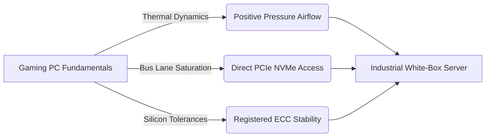
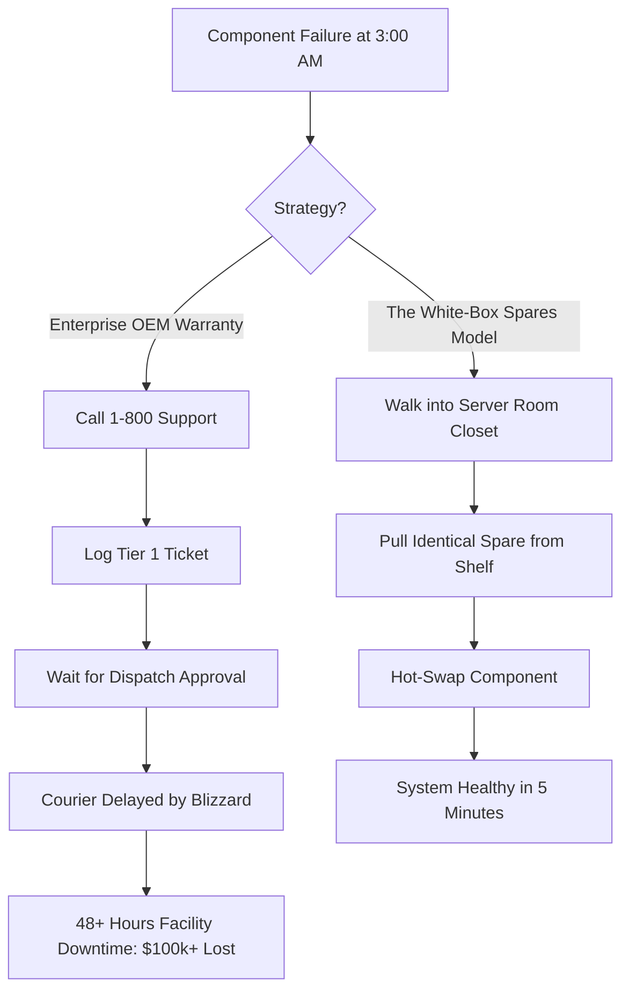

> *"Building a server is not wizardry. It is like building a PC with higher stakes: better parts, licensing you actually read, discipline around backup and disaster recovery, and the care required to design it properly."*

---

## Act I: The $80,000 Slide Deck & The Dying Black Box

When I was managing site-wide IT operations for Canada Fluorspar Inc. (CFI)—an isolated industrial fluorspar mining operation located on the rugged Burin Peninsula of Newfoundland—maintaining server stability was an ongoing knife fight against legacy debt.

Our primary server fleet was aging rapidly. Drives were throwing intermittent SMART errors, hypervisor resource allocations were choking during morning shift arrivals, and our core business applications—running active directory, ERP databases, management consoles, and dispatch telemetry—were living on borrowed time. 

When you tell an executive team that their core infrastructure is nearing end-of-life, the default corporate response is to summon the incumbent Managed Service Provider (MSP). 

A few days later, a glossy enterprise proposal lands on the desk. 

The deck is magnificent. It is thirty pages of corporate buzzwords, full-color diagrams, and a terrifying bill: **over $80,000**. 

The proposal called for:
* Dual-socket, high-tier OEM rackmount servers (Dell PowerEdge or HPE ProLiant) loaded with brand-name markups.
* Multi-socket VMware vSphere / ESXi licensing stacks with mandatory enterprise support tiers.
* Recurring annual cloud management add-ons and monitoring agent retainers.
* An astronomical hourly deployment fee to have a remote third-party technician click "Next" on an automated installer.

When I audited the quote against our actual operational requirements, the disconnect was staggering. The mine did not need dual-socket compute clusters running idle CPU cycles in an air-conditioned room. We had 60 endpoints and 8 core virtual machines. What we needed was raw IOPS throughput, low-latency disk access, robust memory bandwidth, and above all, **independence**.


The fundamental problem with typical MSP recommendations comes down to incentives: **MSPs get paid to sell branded stacks, vendor licenses, and recurring hosted platforms. They do not get paid to help you own your infrastructure and reduce your monthly spend forever.**

I rejected the proposal and decided to design the solution myself.

---

## Act II: From Gaming Rigs to Server Racks

To non-technical executives, an enterprise server is an impenetrable black box imbued with proprietary magic. If the logo on the bezel isn't Dell, Lenovo, or HP, they assume it must be an unstable toy.

That misconception is how vendors extract eight-figure margins from small-to-medium businesses.

The truth is far simpler: **Building a server is not wizardry.** 

For years, I had spent my spare time building and tuning custom desktop computers and high-performance gaming rigs. I obsessed over component clearances, thermal paste application, VRM power delivery, memory timing stability, and bus lane saturation. 

When you strip away the corporate marketing, an enterprise server obeys the exact same laws of physics as a custom PC:
* Electricity flows through a PCB.
* Chips generate thermal heat that must be moved through copper and aluminum fins via forced airflow.
* Data travels across PCIe lanes, subject to bus bandwidth limits and controller latency.



Because I knew what each individual component actually cost—and what it actually did—I couldn't be fooled by glossy slide decks. I didn't need to pay an OEM a 400% markup on an NVMe drive simply because they flashed custom vendor firmware onto an off-the-shelf Samsung or Micron enterprise controller.

I sat down at my workbench and specced out an enterprise Bill of Materials (BOM) from the ground up:
* A heavy-duty 4U rackmount chassis with redundant hot-swap 80+ Platinum power supplies.
* A single-socket AMD EPYC platform designed for dense compute, eliminating the latency and power overhead of multi-socket NUMA interconnects.
* 256GB of Registered ECC DDR4 memory to guarantee memory bit-flip resilience for continuous 24/7 uptime.
* Direct-attached enterprise U.2/U.3 NVMe storage pools configured in ZFS mirrors, delivering hundreds of thousands of random-write IOPS that would leave mechanical RAID arrays in the dust.

The total hardware cost, including full redundancy? **Under $34,000.**

---

## Act III: The Hypervisor Trap & Slaying Windows Core Licensing

Hardware is only half the battle. In modern IT infrastructure, the real extortion happens at the software layer.

Under the traditional enterprise playbook, deploying a dual-socket server with 32 or 64 total cores triggers a cascading nightmare of **per-core licensing**. 

```text
[VENDORS' PER-CORE LICENSING EQUATION]
2 Sockets × 32 Cores = 64 Cores
Windows Server Datacenter License = $6,000+ per 16-core pack
Total Hypervisor OS Licensing Cost = $24,000+ upfront
+ Annual Software Assurance Tax: 25% ($6,000/year)
```

If you install a proprietary hypervisor on bare metal across 64 cores, Microsoft expects you to license every single physical core—even if half of your virtual machines are running lightweight Linux services that don't touch a line of Microsoft code!

To break this trap, I bypassed commercial hypervisors entirely and deployed **Proxmox VE (Virtual Environment)**.

### Why Proxmox VE Destroys Legacy Hypervisors for SMBs
Proxmox VE is built on top of rock-solid Debian Linux and the KVM (Kernel-based Virtual Machine) hypervisor. It is fully open-source, battle-tested, and offers native enterprise capabilities that VMware locks behind six-figure paywalls:

1. **Zero Per-Core Tax:** Proxmox does not care if you have 8 cores or 128 cores. The software is free, and enterprise support subscriptions (if desired) are billed per CPU socket at a fraction of Broadcom/VMware rates.
2. **Native ZFS Storage Integration:** Proxmox includes native, kernel-level support for the ZFS filesystem. That means software-defined RAID, instant copy-on-write snapshots, continuous background data scrub verification, and hardware-agnostic disk portability without needing proprietary RAID controller cards.
3. **LXC Lightweight Containers:** For internal services (reverse proxies, monitoring agents, DNS resolvers), you don't need to spin up full virtual machines with heavy OS overhead. You can run lightweight Linux Containers (LXC) sharing the host kernel, idling at 30MB of RAM.
4. **Selective Guest Licensing:** Instead of licensing the entire bare-metal hypervisor with Windows Server Datacenter, you run Proxmox on the bare metal for free. You then spin up individual Windows Server Standard virtual machines only where specific legacy business software requires them, licensing only the virtual cores assigned to those specific VMs.

The savings on licensing alone was enough to fund the entire hardware purchase.

---

## Act IV: The 3:00 AM Remote Island Reality

When you run IT for a remote facility on an isolated peninsula in Newfoundland, vendor service level agreements (SLAs) are pure fiction.

Enterprise hardware sales reps love to boast about their *"4-Hour On-Site Mission-Critical Hardware Replacement"* warranties. But look at a map. St. Lawrence is a four-hour drive from the nearest regional hub in St. John's—assuming the Trans-Canada Highway isn't shut down by a blinding winter blizzard, freezing rain, or coastal storm surges.

If a proprietary RAID controller fails on a Friday night at 11:00 PM, nobody from Dell or HP is flying into a blizzard on a helicopter to hand-deliver a replacement board before the morning production shift.



**The solution to remote industrial reliability is not an expensive warranty contract; it is on-shelf warm spares.**

With the $46,000 saved by avoiding the OEM quote, we funded an exhaustive inventory of critical spare parts stored directly in the server room:
* Two identical spare enterprise NVMe drives, pre-tested and ready to slide into the front backplane.
* A spare hot-swap 80+ Platinum power supply module sitting in anti-static wrap.
* Identical registered ECC RAM modules.
* A pre-configured cold-spare host motherboard in its original packaging.

If a drive died, ZFS alerted me instantly. I walked into the server room, pulled the bad drive, inserted the spare from the shelf, and initiated a ZFS pool resilver with a single command. 

Downtime: **zero minutes**. Cost of emergency vendor courier: **$0**.

---

## Act V: The 3:00 AM Runbook & Demanding Infrastructure Ownership

The true test of an engineer's work is not how clever the system looks while they are sitting at the keyboard. 

**The true test is what happens if they get hit by a bus tomorrow.**

Too many MSPs and insecure IT technicians build "job security through obscurity." They leave networks undocumented, keep root passwords in their personal browser managers, and configure arcane routing rules that only they understand. When they leave, the client is paralyzed.

That practice is unprofessional and dishonest.

When I designed the white-box build, I paired the physical hardware with an exhaustive, plain-English **3:00 AM Runbook**:
1. **Network Topology & Port Allocations:** A crystal-clear diagram showing every physical patch cable, VLAN tag, and IPMI out-of-band management IP.
2. **Component Bill of Materials & Sourcing:** Part numbers, serial numbers, and direct supplier links for every component in the chassis so any technician could re-order an exact replacement.
3. **Bare-Metal Disaster Recovery Procedures:** Step-by-step terminal commands detailing how to install Proxmox on a fresh disk, import the ZFS storage pool, and restore virtual machines from our hardened Datto backup appliance.

If a catastrophic event occurred at 3:00 AM, a junior technician with basic Linux literacy could follow the binder and bring the entire mine's server infrastructure back online from scratch.

---

## The Four Questions Every Business Must Ask Their MSP

If you are a business owner, executive, or technical director, you are likely being overcharged for infrastructure right now. 

Before you sign another five-figure hardware renewal or six-figure cloud migration quote, sit down with your MSP and ask these four questions:

1. **Who actually owns our backups and encryption keys?**  
   If your contract ends tomorrow, do you hold the keys to your data, or are your backups locked inside a proprietary vendor appliance that becomes a brick when the subscription lapses?
2. **If your company disappeared tonight, could another competent engineer rebuild us?**  
   Do you have full, up-to-date, step-by-step documentation, or are you dependent on the memory of one account rep?
3. **Are your hardware recommendations driven by our workload, or by vendor kickbacks?**  
   Why are we paying for 64 cores of Windows Server Datacenter licensing when our actual application workload only utilizes three virtual instances?
4. **What is our real-world recovery time in a disaster?**  
   Not the theoretical SLA printed on the contract—what is the physical reality when a component dies on a holiday weekend?

---

## The Ethos of Keel Systems

This industrial experience—wrestling with legacy black boxes, exposing predatory MSP retainer billing, and building resilient systems that survived severe ransomware attacks—is the exact foundation upon which **Keel Systems** was built.

I don't sell clients pre-packaged vendor slide decks. I don't pad hardware invoices with multi-hundred-percent markups. 

I build sensible, resilient, documented infrastructure that organizations actually own. 

You don't need an $80,000 branded monument to run your business. You just need the right components, configured with discipline, and documented with honesty.

---

> [!TIP]
> **Want an honest audit of your IT infrastructure?**  
> Explore how we survived an active cyber attack in [Surviving the Akira Ransomware Attack](/articles/my-story-with-the-akira-ransomware-attack.html), read our foundational philosophy in [The Project Atlas Manifesto](/articles/manifesto.html), or reach out directly at **social@thomsfoolery.com** to discuss infrastructure consulting with Keel Systems.
